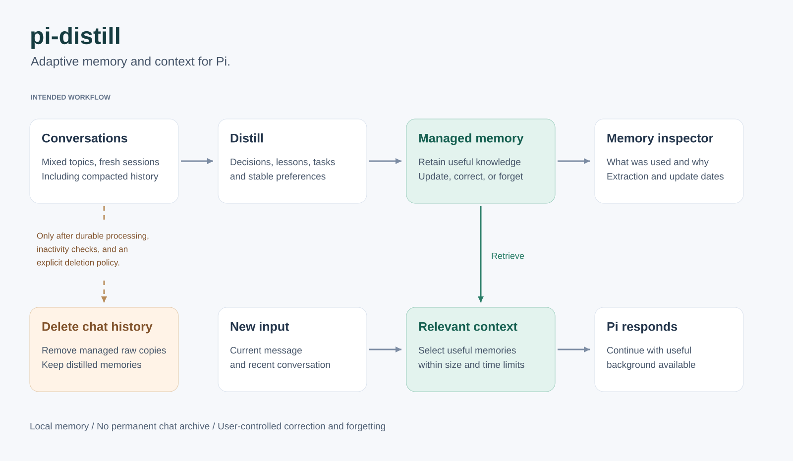

# pi-distill

English | [简体中文](docs/i18n/README.zh-CN.md)

**Adaptive memory and context for Pi.**

pi-distill is an extension for [Pi](https://github.com/earendil-works/pi) that brings memory into everyday conversations.

## Product vision



*Product vision, including the planned memory inspector.*

Open a fresh session and continue your work. pi-distill aims to make relevant memories available wherever the conversation goes.

Sessions are temporary places to talk. You can move between topics and projects, close Pi, and start again without naming conversations or finding the session where a decision was made. You can work in several terminals at once, with each session drawing on the same personal memory store.

The extension maintains memories through ordinary conversation. It brings back the knowledge relevant to the current request, including decisions, preferences, conditions, and unfinished work. You choose what to work on; pi-distill handles remembering and letting old chats go.

pi-distill aims to:

- **Remember useful knowledge:** distill decisions, lessons, preferences, and task state from conversations, including history that has been compacted.
- **Bring back relevant context:** use the current message and recent conversation to bring back helpful memories.
- **Keep memory current:** incorporate corrections, replace outdated conclusions, resolve duplicates, and distinguish completed, paused, and unresolved work.
- **Make memory understandable:** explain which memories were used, why they were selected, and when they were extracted or updated. Let users inspect, correct, and forget them.
- **Let chats go:** delete chat history while retaining distilled memories and the metadata needed to manage them.

```text
Conversations --> Distill --> Memories
      |                         |
      |                         v
      |       New input --> Select context --> Pi responds
      |                         |
      |                         v
      |                    Memory inspector
      |                    - What was used?
      |                    - Why was it selected?
      v
Delete chat history
```

### Keep the knowledge, let the chats go

Useful knowledge lives on in memories after its original conversation is gone. Completed memory processing and the end of session use make old chats eligible for automatic cleanup. A fresh session continues from relevant memories, so continuity comes from what was learned rather than from reopening a particular chat.

### Design principles

- Store and manage memory locally.
- Apply memories in the context of the current request.
- Preserve conditions, uncertainty, and alternative conversation branches.

## Available today

### Automatic distillation and cleanup

When a session ends or compaction succeeds, pi-distill records distillation work. A live Pi uses its model to process that evidence in the background, creating, correcting, or deleting memories as the conversation warrants. Exit saves pending work; after the last Pi process closes, it continues on the next startup.

Cleanup independently performs local checks and deletes managed chat files once processing is complete, use has ended, and dependencies are resolved. Memories remain available. Knowledge from a just-closed conversation becomes searchable after distillation commits it. See [Distillation and cleanup](docs/distillation-and-cleanup.md) for queue timing and diagrams.

### Agentic memory search

Pi's current model chooses keywords and alternate expressions or languages through `memory_search`, then uses `memory_read` to inspect candidates and judge applicability. SQLite performs literal matching. Memories remain searchable across projects, with their original conditions and context.

Search and read results appear in Pi's tool cards. Expanded results show search terms, matching previews, read content, and memory update times. See [Agentic memory search](docs/agentic-search.md) for tool contracts and retrieval behavior.

### Local storage and recovery

Memories and task queues persist in local SQLite. The extension supports normal Pi loading and reload, coordinates multiple Pi processes sharing the store, and recovers persisted pending work after restart. Distillation uses the claiming Pi's configured model and sends relevant evidence to that model provider.

## Recommended use

Start fresh with `pi` or `/new`, and let relevant memories carry your work forward. While automatic cleanup is running, leave old session files to the extension. The [operation checklist](docs/distillation-and-cleanup.md#operations-to-avoid-with-automatic-cleanup) lists Pi's old-session commands and UI actions to avoid, with reasons and current-session distinctions. See [Distillation and cleanup](docs/distillation-and-cleanup.md) for timing and diagrams.
