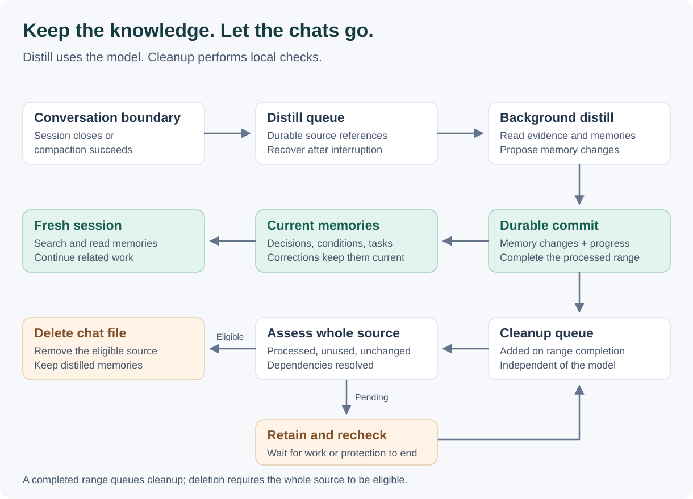
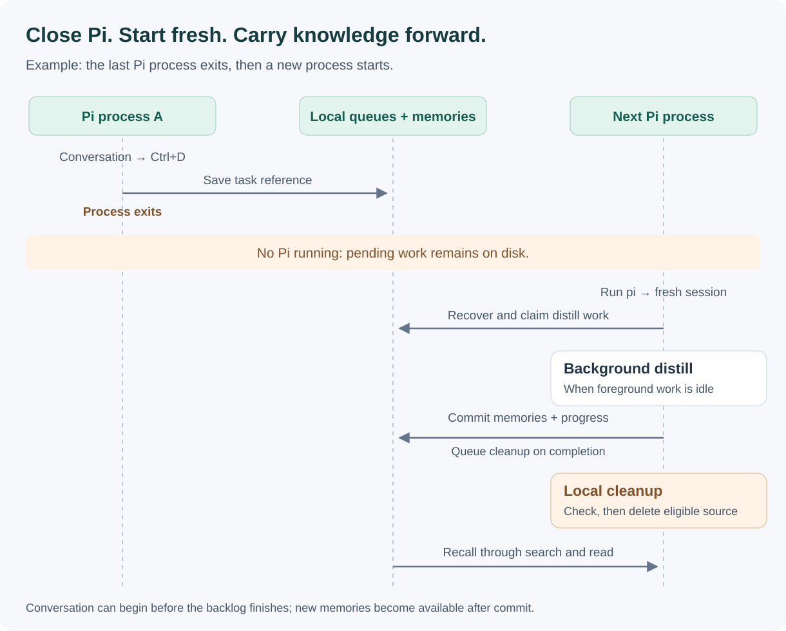

# Distillation and cleanup

English | [简体中文](i18n/distillation-and-cleanup.zh-CN.md)

pi-distill keeps useful knowledge available across fresh Pi sessions. You can discuss several topics in one conversation, close it, and start again. Distillation turns conversation evidence into lasting memories; cleanup removes processed chat files when they are no longer in use. [Agentic memory search](agentic-search.md) brings relevant memories into later conversations.

## Recommended use: start fresh

Run `pi` to start a fresh conversation, or use `/new` inside Pi. Discuss any topics you need, then close the session when you are done. Multiple terminals can each run a fresh session and share the same personal memory store. Relevant memories provide continuity as you move between conversations.

### Operations to avoid with automatic cleanup

The following inventory covers the built-in old-session entry points in Pi **1.3.0**, the version used by this project. Avoid these operations on extension-managed history while any Pi process can run cleanup. Use `pi` or `/new` to continue your work. [The cleanup limitation](#old-session-operations-and-cleanup) explains why old-file access needs coordination.

| Operation | Entry points | Why to avoid it |
| --- | --- | --- |
| Continue the latest saved session | `pi --continue`, `pi -c` | Opens an old file before the extension loads |
| Browse and resume saved sessions at startup | `pi --resume`, `pi -r` | Reads saved files for the selector and opens the selected file before extension protection |
| Open a saved session by path or ID | `pi --session <path-or-id>` | Opens an old source; selecting one from another project may also offer to fork it |
| Reuse an existing exact session ID | `pi --session-id <existing-id>` | Reopens the matching saved file; a previously unused ID instead creates a fresh session |
| Fork a saved session at startup | `pi --fork <path-or-id>` | Reads an old source before extension protection, even though the resulting session is new |
| Browse or switch to saved sessions inside Pi | `/resume`; a configured `app.session.resume` shortcut; session-list browsing, filtering, and selection | The selector reads old files; those reads and the subsequent open are outside cleanup coordination |
| Rename an old session from the list | Session-list rename action; default `Ctrl+R` | Opens and writes the selected old file directly |
| Delete a saved session manually | Session-list delete action; default `Ctrl+D`, or `Ctrl+Backspace` with an empty query | Bypasses distillation completion and source-use checks; may remove evidence still needed by queued work |
| Import and resume saved conversation data | `/import <path.jsonl>` | Reads or copies a source and opens the imported session; access to a managed source is not reserved against cleanup |
| Export an old session file from the CLI | `pi --export <file> [output.html]` | Opens the source directly, outside extension protection |

The same guidance applies when scripts, SDK/RPC clients, or other extensions open, copy, edit, move, rename, or delete managed session files. Custom commands and shortcuts inherit the behavior of the operation they invoke. Their arbitrary names are not part of the built-in inventory above.

**Current-session operations have a different boundary.** `/name` and `--name`/`-n` name the current session; `/tree` navigates it; `/fork` and `/clone` derive a session from the current protected conversation. A configured fork shortcut or double-Escape fork action follows that current-session path. These are not the old-file pre-open race listed above. Fresh sessions remain the recommended way to carry work forward; fork dependencies can keep parent chat files around longer. `/export` and `/share` act on the current session but create copies outside automatic source cleanup.

In the normal empty conversation editor, `Ctrl+D` exits Pi; in the session list, it deletes the selected session. `/compact`, `/reload`, `/new`, normal exit, and multiple fresh-session terminals remain part of the ordinary workflow. Keep session persistence and pi-distill loaded for durable background processing; `--no-session` does not provide restart recovery for unsaved conversation content.

## Two tasks, one lifecycle

Distillation and cleanup have separate persistent queues. Distillation uses a model to decide how memories should change. Cleanup uses local checks to decide whether a source file can be deleted.

*Figure 1. Memory maintenance and source cleanup are connected by durable completion. Cleanup leaves the memory store available for future conversations.*

A completed distill range can produce new memories, update existing ones, remove superseded knowledge, or make no changes. All four outcomes can count as successful processing. A cleanup task asks for the whole file to be assessed: completing one range does not establish that every part of the file is ready to remove.

## When work happens

A **Pi process** is the running application in a terminal. A **session** is the conversation it currently holds. Running `pi` starts a process with a fresh session; `/new` starts a fresh session within that process. Exiting Pi also ends its current session.

| Event | Immediate work | Subsequent work |
| --- | --- | --- |
| Start Pi | Register the current session's use | Recover pending work and check cleanup tasks |
| Talk normally | Record source positions for recovery | Search and read committed memories when useful |
| Successfully compact a session | Record the completed compaction boundary | Distill that conversation range; retain the active session file |
| Start `/new` | Record the old session's distill task and protect the new session | Process the old conversation and assess its cleanup |
| Exit Pi, including Ctrl+D | Save a compact task reference and stop this runtime's workers | Another live Pi can process pending tasks; otherwise the next Pi startup resumes them |
| Reload the extension | Transfer protection and restart workers | Resume pending work without treating reload as a new extraction trigger |
| Process crashes or the computer turns off | Recovery relies on records already saved to disk | A later Pi recovers pending work and checks the saved conversation tail |

The exit hook records identifiers and the conversation boundary. Reading history and calling the model happen in a live Pi runtime after that. When the last Pi process exits, queues remain on disk until Pi runs again.

*Figure 2. Closing the last Pi process and starting another. An already-running Pi can also claim pending work.*

Committed memories are immediately available to search. Knowledge from a just-closed conversation becomes available as background distillation commits it; opening a fresh session does not wait for the entire backlog.

## What distillation keeps

Memories express knowledge that can stand on its own: preferences, decisions, lessons, conditions, and unresolved task state. They retain enough context to explain where a conclusion applies.

For example, one conversation might establish both:

- Birch project logs are kept for 14 days normally, or 30 days during an incident investigation.
- The user prefers oolong tea.

These become separate pieces of knowledge. A later conversation changing Birch's normal retention period to 21 days can update that decision while preserving its incident exception and the unrelated tea preference. Ordinary corrections supply the evidence for memory maintenance.

For each batch, distillation:

1. Reads the recorded conversation range and identifies evidence that remains unprocessed.
2. Searches and reads existing memories to find related knowledge.
3. Proposes creates, updates, deletions, or no change, with references to the new evidence.
4. Validates the proposal, including current memory revisions and branch relationships.
5. Commits memory changes and processing progress together. When the range completes, its cleanup task is recorded in the same transaction.

Memories retain their current content rather than a history of previous revisions. An internal revision number detects conflicting updates. Distinct conversation branches retain their conditions; a conclusion from one branch does not silently replace an alternative from another.

Long conversations are split into bounded batches. Each batch carries up to 24 KiB of serialized new evidence and up to 8 KiB of earlier interpretation context, further constrained by the model request budget. Already-processed evidence is skipped across overlapping close and compact events. A source that exceeds the reader's limits remains pending rather than being marked complete from a truncated view.

The live Pi runtime claiming the task supplies its current model and credentials. Conversation evidence and retrieved memories used for distillation go to that configured model provider. Memories, task state, and cleanup metadata are stored locally, normally in `~/.pi/agent/distill/memories.sqlite`.

## When a chat file is deleted

Cleanup evaluates extension-managed source files. A file becomes eligible when:

- All relevant conversation evidence is durably processed, including recorded branch positions and compaction ranges.
- Pending capture or distill work for that source has been resolved.
- Registered session users have released it or their processes are confirmed to have exited.
- Source readers have finished, and no surviving dependent session still needs the file.
- File identity, contents, and relevant database state still match the assessment immediately before deletion.

A recorded position is simply the point in a conversation that processing or recovery needs to cover. If another session depends on a parent conversation file, cleanup retains the parent until that dependency has been removed.

Cleanup removes the eligible source chat file. It keeps distilled memories and metadata for evidence identity, processing progress, concurrency, and deletion recovery. It creates no transcript archive. Files outside the extension's managed sources are outside this cleanup scope.

### Old-session operations and cleanup

Pi can start opening an old session before it loads the extension. Some session-list operations, including renaming an old session, also access the file without a hook that lets the extension reserve it first. Another Pi process could therefore assess that file as unused and delete it while the first process is reading or modifying it. The extension cannot coordinate those native accesses with cleanup.

This race concerns concurrent access to an old file, not merely selecting a file that was already deleted. Waiting a little longer before cleanup does not establish mutual exclusion. Starting a fresh session with `pi` or `/new` avoids opening that old source; the new conversation obtains earlier knowledge through the memory store. Pi's old-session commands remain available, so the recommended workflow is usage guidance rather than an enforced restriction.

## Multiple terminals and interrupted work

Live Pi runtimes claim work through the shared SQLite database. At most one background distill attempt runs per shared store. Each new background model request waits for the claiming runtime's foreground conversation, compaction, and retry work to be idle. Starting foreground work does not cancel a model request already sent.

Cleanup runs independently of model availability and foreground model activity. Task claims coordinate competing cleaners; a shared source-access reservation coordinates extension source reads with deletion. An open session in another terminal keeps its file protected even when that terminal is idle. A timed-out worker claim alone does not establish that a session is unused.

| Interruption | Recovery behavior |
| --- | --- |
| Model unavailable, invalid output, or conflicting memory update | Preserve source and pending work for a later attempt |
| Pi exits during distillation | Stop this runtime's attempt; prevent its late response from committing; retain recoverable work |
| Shutdown hook never runs | Recover from saved session-use records, observed positions, and readable persisted source data |
| Source changes during cleanup assessment | Retain it and assess the new state later |
| Process exits after unlinking the file but before recording completion | Use the durable deletion intent to reconcile the missing file and complete cleanup |
| Another file replaces the source at the same path | Preserve the replacement rather than apply the old deletion intent |

Recovery covers data already persisted by Pi and the extension. Conversation content that never reached disk cannot be recovered after power loss.

## Implementation map

- [Pi event integration](../src/index.ts): connects session events, usage tracking, and workers.
- [Distillation coordinator](../src/consolidation.ts) and [model interaction](../src/consolidation-model.ts): prepare, claim, and process bounded evidence.
- [Cleanup coordinator](../src/cleanup.ts) and [retention assessment](../src/session-retention.ts): check eligibility and remove source files.
- [SQLite store](../src/memory-store.ts): persistent queues, atomic memory commits, claims, and deletion recovery.

Return to the [product overview](../README.md).
