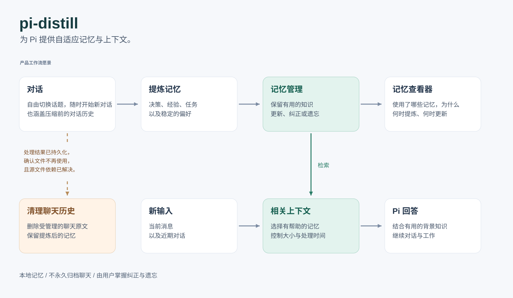

# pi-distill

[English](../../README.md) | 简体中文

**留下知识，随时开始新对话。**

pi-distill 为 [Pi](https://github.com/earendil-works/pi) 提供跨对话的记忆。它从聊天中提炼有用的知识，在后续工作中检索相关记忆，并清理处理完成的聊天历史。

一个 session 可以讨论多个话题、处理多个项目，也可以只回答一个临时问题。你可以随时开始新 session，让决定、偏好、经验和未完成的工作通过记忆延续。

## 安装

需要 Node.js **22.19.0+** 和 Pi；已验证的 Pi 集成版本为 **1.3.0**。

```sh
pi install git:github.com/dyxcode/pi-distill@v0.1.0
pi
```

在 Pi 中选择已配置的模型，即可开始对话。若 Pi 已打开，使用 `/reload` 加载新安装的扩展。

Checkout 安装、升级和卸载的说明见[安装指南](installation.zh-CN.md)。

## 日常使用

像平时一样与 Pi 工作。例如，你可以告诉它：

> Cedar 项目平时保留 14 天日志，事故调查期间保留 30 天。

这段对话完成提炼后，新 session 可以在你再次处理 Cedar 时检索到这条规则。规则发生变化时，直接在对话中说明：

> Cedar 平时改为保留 21 天日志，事故调查规则保持原样。

这条修正会成为更新记忆的证据。记忆保留事实的适用条件，由模型结合当前项目和话题判断是否相关。

使用 `/new` 开始另一段对话，或退出 Pi 后重新运行 `pi`。多个终端可以共享同一个个人记忆库。

**推荐始终从新 session 继续工作。** 自动清理可能与 Pi 原生的旧 session 文件访问同时发生。处理已保存的聊天时，请遵循[旧 session 操作清单](distillation-and-cleanup.zh-CN.md#自动清理期间应避免的操作)。

## 记忆如何工作

1. **提炼。** Session 结束或压缩成功后，扩展记录待处理工作。运行中的 Pi 使用已配置的模型在后台提炼知识，并创建、更新或删除记忆。
2. **检索。** 在之后的对话中，Pi 的模型通过 `memory_search` 选择关键词，用 `memory_read` 读取候选，再判断哪些记忆适用。搜索和读取结果显示在 Pi 的工具卡片中。
3. **清理。** 受管理的聊天完成处理、不再被使用，且相关依赖已解决后，cleanup 删除源文件，保留提炼出的记忆。

新知识在提炼保存后变得可检索。退出时会快速记录待办工作，由其他运行中的 Pi 继续处理，或在下次启动 Pi 时恢复。

## 你的数据

记忆和待办工作保存在本地 SQLite 中，通常位于 `~/.pi/agent/distill/`。新 session 使用同一个记忆库；重启后，后台处理也从这里继续。

提炼会将相关对话证据和检索到的记忆发送给 **Pi 中配置的模型服务商**。搜索与清理在本地执行。故障、工作阻塞和恢复的诊断记录保存在本机，记录范围与保留限制见[本地数据指南](installation.zh-CN.md#本地数据)。

## 产品愿景

Session 是临时的工作空间，有用的知识应当随着工作延续。我们希望通过普通对话维护记忆，并保留它的背景、适用条件和不确定性。



*产品愿景。图中的记忆查看器仍在规划中，将解释本次使用了哪些记忆、它们来自哪里，以及为什么被选中。*

## 进一步了解

- [安装与本地数据](installation.zh-CN.md)：安装、升级、卸载和诊断日志。
- [记忆提炼与聊天清理](distillation-and-cleanup.zh-CN.md)：处理时机、多终端、故障恢复与 session 操作。
- [Agentic memory search](agentic-search.zh-CN.md)：关键词选择、字面匹配与证据读取。

## 许可证

[MIT](../../LICENSE)。
