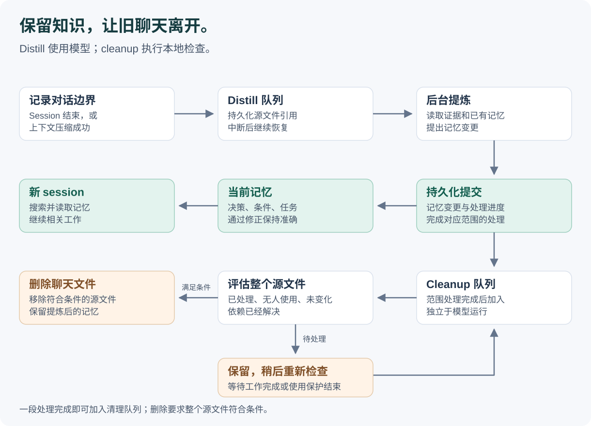
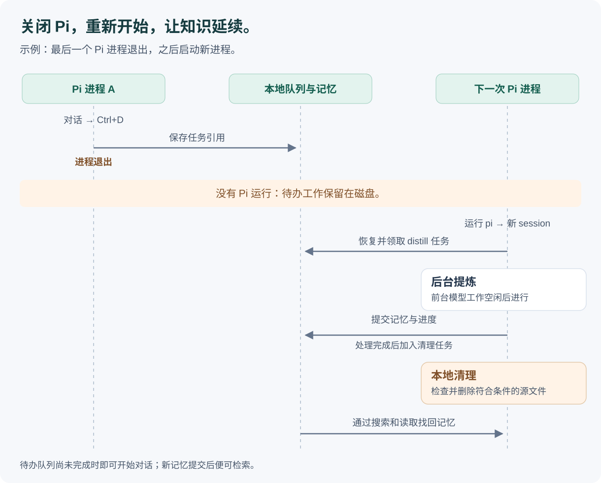

# 记忆提炼与聊天清理

[English](../distillation-and-cleanup.md) | 简体中文

pi-distill 让有用的知识在新的 Pi session 中继续可用。你可以在一次对话中讨论多个话题，关闭后随时重新开始。记忆提炼（distillation）将对话中的证据转化为长期记忆；聊天清理（cleanup）在处理完成、文件不再被使用后删除聊天原文。[Agentic memory search](agentic-search.zh-CN.md) 则在后续对话中找回相关记忆。

## 推荐用法：从新 session 开始

直接运行 `pi` 开始新对话，或在 Pi 内使用 `/new`。你可以自由讨论不同话题，结束时关闭 session。多个终端可以各自开启新 session，共享同一个个人记忆库。相关记忆让工作在不同对话之间延续。

### 自动清理期间应避免的操作

下面列出本项目使用的 **Pi 1.3.0** 中内置的旧 session 操作入口。只要有 Pi 进程可能执行 cleanup，就应避免对扩展管理的历史执行这些操作。继续工作时使用 `pi` 或 `/new`。[清理限制](#旧-session-操作与清理)解释了旧文件访问为何需要协调。

| 操作 | 入口 | 应避免的原因 |
| --- | --- | --- |
| 继续最近保存的 session | `pi --continue`、`pi -c` | 在扩展加载前打开旧文件 |
| 启动时浏览并恢复已保存的 session | `pi --resume`、`pi -r` | 列表会读取已保存文件；选中文件也在扩展建立保护前打开 |
| 按路径或 ID 打开已保存的 session | `pi --session <path-or-id>` | 打开旧源文件；选中其他项目的 session 时还可能提示 fork |
| 复用已有的完整 session ID | `pi --session-id <existing-id>` | 重新打开匹配的已保存文件；此前不存在的 ID 则会创建新 session |
| 启动时从已保存的 session fork | `pi --fork <path-or-id>` | 即使结果是新 session，也会先在扩展建立保护前读取旧源文件 |
| 在 Pi 内浏览或切换到已保存的 session | `/resume`；配置的 `app.session.resume` 快捷键；session 列表的浏览、筛选与选择 | 列表读取旧文件；这些读取和后续打开不参与 cleanup 协调 |
| 在列表中重命名旧 session | Session 列表的重命名操作；默认 `Ctrl+R` | 直接打开并写入选中的旧文件 |
| 手动删除已保存的 session | Session 列表的删除操作；默认 `Ctrl+D`，或查询为空时的 `Ctrl+Backspace` | 绕过提炼完成和文件使用检查，可能删除队列中任务仍需要的证据 |
| 导入并恢复已保存的对话数据 | `/import <path.jsonl>` | 读取或复制源文件，再打开导入后的 session；对受管理源文件的访问没有取得 cleanup 互斥保护 |
| 从 CLI 导出旧 session 文件 | `pi --export <file> [output.html]` | 在扩展保护之外直接打开源文件 |

脚本、SDK/RPC 客户端或其他扩展对受管理 session 文件执行打开、复制、编辑、移动、重命名、删除时，同样适用上述建议。自定义命令和快捷键取决于它们实际调用的操作；上表列的是内置入口，不枚举任意自定义名称。

**当前 session 的操作有不同边界。** `/name` 和 `--name`／`-n` 为当前 session 命名；`/tree` 在其中导航；`/fork` 和 `/clone` 从当前受保护的对话派生 session。配置的 fork 快捷键或双击 Escape 的 fork 操作也走当前 session 路径。这些不属于上表所说的旧文件打开前 race。延续工作仍推荐新建 session；fork 依赖可能让父聊天文件保留更久。`/export` 和 `/share` 操作当前 session，但产生的副本不属于自动源文件清理范围。

在正常对话的空输入框中，`Ctrl+D` 用于退出 Pi；在 session 列表中，它用于删除选中的 session。`/compact`、`/reload`、`/new`、正常退出，以及多终端各自开启新 session，仍属于日常使用方式。要进行持久化后台处理，应保留 session 保存功能并加载 pi-distill；`--no-session` 无法为未保存的对话内容提供重启恢复。

## 两类任务，一个生命周期

Distill 和 cleanup 各有独立的持久化队列。Distill 使用模型判断记忆应该如何变化；cleanup 通过本地检查判断源文件是否可以删除。

*图 1：记忆维护与聊天清理由已持久化的处理结果衔接。清理后，记忆仍可供后续对话使用。*

一次 distill 可以创建记忆、更新已有记忆、删除被替代的知识，也可以判断无需变更。这四种结果都可以构成成功处理。清理任务会评估整个文件：某一段处理完成，并不意味着整个文件都已满足删除条件。

## 什么时间做什么

**Pi 进程**是终端里运行的应用。**Session** 是它当前承载的对话。运行 `pi` 会启动一个进程和新的 session；`/new` 在同一进程中开始新的 session。退出 Pi 也会结束当前 session。

| 事件 | 立即进行的工作 | 后续工作 |
| --- | --- | --- |
| 启动 Pi | 登记当前 session 正在被使用 | 恢复待办工作，检查清理任务 |
| 正常对话 | 记录用于恢复的对话位置 | 在有帮助时搜索、读取已提交的记忆 |
| Session 压缩成功 | 记录已完成压缩的对话边界 | 提炼对应范围；保留仍在使用的 session 文件 |
| 使用 `/new` | 记录旧 session 的 distill 任务，保护新 session | 处理旧对话，评估其清理条件 |
| 退出 Pi，包括 Ctrl+D | 保存简短的任务引用，停止本运行实例的 worker | 其他运行中的 Pi 可以接手；否则等下次启动 Pi 后恢复 |
| 重新加载扩展 | 移交使用保护，重新启动 worker | 继续待办工作；reload 本身不触发新的提炼 |
| 进程崩溃或电脑关机 | 依靠此前已写入磁盘的记录恢复 | 后续 Pi 恢复待办工作，并检查对话已保存的末尾内容 |

退出 hook 记录标识和对话边界。读取历史、调用模型由之后运行中的 Pi 承担。最后一个 Pi 进程退出后，队列保留在磁盘上，等 Pi 再次运行时继续处理。

*图 2：关闭最后一个 Pi 进程，再启动新进程的时序。已经运行中的另一个 Pi 也可以领取待办工作。*

已提交的记忆立即可供搜索。刚结束的对话会随着后台提炼提交而成为可检索的知识；新 session 启动时不会等待整个待办队列处理完毕。

## Distill 保留什么

记忆表达能够独立理解的知识，包括偏好、决策、经验、适用条件和未解决的任务状态。它保留足够的背景，让模型能判断结论适用于哪里。

例如，一次对话可以同时确定：

- Birch 项目日志通常保留 14 天，事故调查期间保留 30 天。
- 用户偏好乌龙茶。

它们形成不同的知识。后续对话将 Birch 的常规保留时间改为 21 天时，可以更新对应决策，同时保留事故调查的例外和无关的饮茶偏好。日常对话中的修正就是记忆维护的证据。

每批 distill 会：

1. 读取已记录的对话范围，识别尚未处理的证据。
2. 搜索、读取已有记忆，找到相关知识。
3. 提出创建、更新、删除或无需变更的结果，并引用新证据。
4. 验证结果，包括当前记忆 revision 和对话分支关系。
5. 一起提交记忆变更与处理进度。范围处理完成时，在同一事务中记录清理任务。

记忆保存当前内容，不保留过去各版本的历史。内部 revision 用来检测更新冲突。不同对话分支保留各自条件；一个分支的结论不会悄悄覆盖另一个分支中的不同选择。

较长的对话会拆成有大小上限的批次。每批最多包含 24 KiB 序列化的新证据和 8 KiB 较早的解释背景，同时受模型请求预算进一步约束。关闭和压缩事件覆盖重叠内容时，已处理的证据会被跳过。超出读取限制的源文件保持待处理，不会根据被截断的视图标记完成。

领取任务的 Pi 运行实例提供其当前模型与凭据。用于提炼的对话证据和检索到的记忆会发送给该模型服务商。记忆、任务状态和清理 metadata 存储在本地，通常位于 `~/.pi/agent/distill/memories.sqlite`。

## 聊天文件何时删除

Cleanup 评估扩展管理的源文件。文件满足以下条件后才具备删除资格：

- 所有相关对话证据均已持久化处理，包括已记录的分支位置和压缩范围。
- 该源文件待捕获或待提炼的工作已经解决。
- 已登记的 session 使用者释放了文件，或其进程已被确认退出。
- 源文件读取已经结束，也没有其他仍保留的 session 依赖该文件。
- 删除前，文件身份、内容及相关数据库状态仍与评估时一致。

记录的对话位置，就是处理或恢复需要覆盖到的那个点。如果另一个 session 依赖父对话文件，cleanup 会保留父文件，直到对应依赖被移除。

Cleanup 删除符合条件的聊天源文件，保留提炼后的记忆，以及证据身份、处理进度、并发协调和删除恢复所需的 metadata。它不创建聊天归档。扩展所管理源文件之外的文件不属于此次清理范围。

### 旧 session 操作与清理

Pi 可能在加载扩展之前就开始打开旧 session。部分 session 列表操作，包括重命名旧 session，也会直接访问文件，没有供扩展事先取得访问保护的 hook。此时另一个 Pi 进程可能将该文件评估为无人使用，并在前者读取或修改时删除它。扩展无法将这些原生访问与 cleanup 协调起来。

这里的 race 指同时访问和删除旧文件，而不只是选择了一个已经被删除的文件。清理前多等一会儿无法建立互斥。通过 `pi` 或 `/new` 新建 session，可以避免打开那个旧源文件；新对话通过记忆库获取之前的知识。Pi 的旧 session 命令仍然可用，因此这是推荐使用方式，并非扩展强制禁止这些操作。

## 多终端与中断恢复

运行中的 Pi 通过共享 SQLite 数据库领取任务。每个共享记忆库最多同时运行一次后台 distill 尝试。每次发起新的后台模型请求前，都会等待领取任务的运行实例结束前台对话、压缩或重试工作。新前台工作开始时，已经发出的模型请求不会因此被取消。

Cleanup 独立于模型可用性和前台模型活动运行。任务领取机制协调多个清理 worker；共享的源文件访问预约协调扩展内部的读取与删除。另一个终端即使空闲，只要 session 仍被使用，其文件就保持受保护。后台任务的领取超时本身不代表 session 已无人使用。

| 中断情况 | 恢复行为 |
| --- | --- |
| 模型不可用、输出无效或记忆更新冲突 | 保留源文件和待办工作，留待后续尝试 |
| Distill 过程中 Pi 退出 | 停止本运行实例的尝试，阻止迟到结果提交，保留可恢复的工作 |
| Shutdown hook 未能执行 | 根据已保存的 session 使用记录、观察到的位置和可读取的持久化源数据恢复 |
| 清理评估期间源文件发生变化 | 保留文件，稍后根据新状态重新评估 |
| 文件已删除，但进程在记录完成前退出 | 根据持久化的删除意图确认文件已不存在，补全清理状态 |
| 同一路径被另一个文件替换 | 保留替换后的文件，不对它执行旧的删除意图 |

恢复覆盖 Pi 和扩展已持久化的数据。断电前尚未写入磁盘的对话内容无法恢复。

## 实现入口

- [Pi 事件集成](../../src/pi/lifecycle.ts)：连接 session 事件、使用跟踪和 worker。
- [Distill 协调器](../../src/distill/coordinator.ts)与[模型交互](../../src/distill/model.ts)：准备、领取和处理有大小上限的证据批次。
- [Cleanup 协调器](../../src/retention/coordinator.ts)与[源证据覆盖检查](../../src/storage/coverage.ts)：检查删除条件并移除源文件。
- [SQLite 存储](../../src/storage/store.ts)：持久化队列、记忆原子提交、任务领取与删除恢复。

返回[产品介绍](README.zh-CN.md)。
